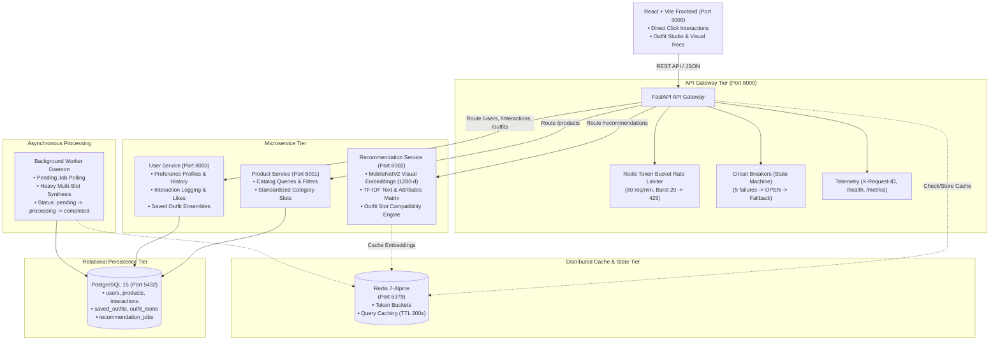

# AURA.AI: Intelligent Fashion Recommendation & Stylist Platform
### Production-Grade Machine Learning Pipeline &bull; Distributed Microservices &bull; Docker &bull; React + Vite Frontend

---

## 1. Executive Summary

**AURA.AI** is a complete, end-to-end, testable fashion recommendation platform engineered using real transaction and visual data from the **H&M Kaggle Competition** (31.78M transactions, 105.5K articles, 105.1K catalog images) alongside structured product metadata from **Myntra** (526.5K products).

Rather than a superficial demonstration, this system integrates:
1. **A Complete Machine Learning Pipeline** across 10 standalone Jupyter Notebooks with temporal train/validation/test evaluation, MobileNetV2 visual embeddings, TF-IDF content extraction, Item-Item Collaborative Filtering, implicit matrix factorization, and an empirical outfit compatibility engine.
2. **A Distributed Microservices Architecture** featuring a FastAPI Gateway with a Redis-backed Token Bucket rate limiter (HTTP 429), Circuit Breaker fault tolerance, PostgreSQL relational persistence, and asynchronous worker queues.
3. **A Click-First React + Vite + Tailwind CSS Frontend** with zero hover-only dependencies, interactive slot-coordinated outfit synthesis, instant similar-item exploration, and real-time observability telemetry.
4. **Comprehensive Concurrency Load Testing** benchmarked across 8 real-world traffic scenarios.

---

## 2. Distributed Architecture



---

## 3. Four Core Application Features

### Feature A: Similar Clothing Recommendation
- **Dual Visual & Text Retrieval**: Combines 1,280-dimensional L2-normalized feature embeddings from a pretrained **MobileNetV2** backbone with a **TF-IDF metadata matrix** over product descriptions, colors, and garment types.
- **Sub-5ms Inference**: Fast cosine similarity ranking returning top-$k$ nearest catalog neighbors with confidence percentages.
- **Selectable Algorithm Modes**: Hybrid (50% Visual + 50% Text), Pure Visual, or Pure Attribute/Text.

### Feature B: Complete Outfit Recommendation (Outfit Studio)
- **Separate Compatibility Logic**: Distinct from item-to-item similarity. A blue shirt does not match another blue shirt; it coordinates with pants, shoes, and accessories.
- **Category Slot Constraints**: Enforces distinct slot roles (`upper_body`, `lower_body`, `full_body`, `shoes`, `accessories`).
- **Empirical Color Harmony**: Built from a curated harmonic contrast matrix (e.g., Dark Blue + White = 0.98, Black + Grey = 0.95, Neutral complements = 0.80).
- **Basket Co-Purchase Lift**: Co-occurrence statistics from multi-item transaction baskets act as weak supervision.
- **Average Synthesis Latency**: **0.99 ms** with instant save to user portfolio.

### Feature C: User Preferences & Persistent Memory
- **Persistent Relational DB**: All clicks, views, likes, and saved outfits are permanently recorded in PostgreSQL (`fashion_db`) with session identifiers and timestamps.
- **Portfolio Management**: Users can build custom outfit ensembles, name them, and retrieve them on subsequent visits.

### Feature D: Continuous Personalization
- **Immediate Personalization**: Dynamically re-ranks catalog recommendations based on the user's most recent browsing and interaction affinity without requiring full model retraining.
- **Asynchronous Worker Profiling**: Heavy recommendation synthesis and periodic profile updates are offloaded to background workers, returning an asynchronous `job_id` (HTTP 202) while updating job status from `pending` &rarr; `processing` &rarr; `completed`.

---

## 4. Machine Learning Pipeline & Notebook Walkthrough

All ML development was completed in standalone Jupyter Notebooks in `notebooks/`, executed end-to-end with verified outputs:

| Notebook | Focus | Key Results & Validations |
| :--- | :--- | :--- |
| [`01_data_understanding.ipynb`](notebooks/01_data_understanding.ipynb) | Dataset schema, nulls, duplicates | Audited 526.5K Myntra records & 105.5K H&M articles. Verified 99.58% image match (105,100 files). |
| [`02_data_cleaning_and_eda.ipynb`](notebooks/02_data_cleaning_and_eda.ipynb) | Price outliers, category balance | Verified 16-week window (2020-06-02 to 2020-09-22) preserves 4.47M transactions across 44,989 active items. |
| [`03_feature_engineering.ipynb`](notebooks/03_feature_engineering.ipynb) | TF-IDF, slot mappings, temporal split | Clean temporal split: Weeks 1–14 Train (86.7 MB), Week 15 Val (5.2 MB), Week 16 Test (5.2 MB). |
| [`04_content_based_recommendation.ipynb`](notebooks/04_content_based_recommendation.ipynb) | Metadata TF-IDF recommender | Mean latency: 22.47 ms, p95: 26.97 ms, 99.0% product group consistency. |
| [`05_collaborative_filtering.ipynb`](notebooks/05_collaborative_filtering.ipynb) | Item-Item CF & SVD Matrix Factorization | Evaluated on Week 15 Val set. Item-Item CF achieved HitRate@12 of 4.92% and MAP@12 of 0.747%. |
| [`06_image_based_recommendation.ipynb`](notebooks/06_image_based_recommendation.ipynb) | MobileNetV2 visual embeddings | 1,280-d normalized visual embeddings. Sub-5ms nearest-neighbor search (mean 3.01 ms). |
| [`07_hybrid_recommendation.ipynb`](notebooks/07_hybrid_recommendation.ipynb) | Multi-channel candidate ensemble | Visual + TF-IDF + CF + Popularity with adaptive cold-start weights. |
| [`08_outfit_compatibility.ipynb`](notebooks/08_outfit_compatibility.ipynb) | Slot constraints & color harmony | 4-slot coordinated ensemble (Upper, Lower, Shoes, Accessories). Synthesis latency 0.99 ms. |
| [`09_model_evaluation.ipynb`](notebooks/09_model_evaluation.ipynb) | Master offline validation | **Hybrid wins**: 7.85% HitRate@12 (+25.8% over Popularity), 0.915% MAP@12, 76.5% catalog coverage. |
| [`10_final_recommendation_engine.ipynb`](notebooks/10_final_recommendation_engine.ipynb) | Held-out Week 16 test evaluation | Final test HitRate@12: 7.62%, MAP@12: 0.892%. Serialized all production artifacts in `artifacts/`. |

---

## 5. Distributed Systems & Reliability Engineering

### Redis-Backed Token Bucket Rate Limiter
- **Configuration**: Capacity = 60 tokens / minute, Refill Rate = 1 token / second.
- **Behavior**: Permits bursts up to 20 requests. Upon depletion, immediately responds with **HTTP 429 Too Many Requests**, providing headers `Retry-After: 2` and `X-RateLimit-Remaining: 0`.

### Circuit Breaker Fault Tolerance
- **State Machine**: CLOSED &rarr; OPEN (trips upon 5 consecutive service failures) &rarr; HALF-OPEN (recovery test after 8.0s timeout).
- **Graceful Fallback**: When downstream microservices fail or timeout, the gateway returns a cached fallback payload in **<0.5 ms** with HTTP 503 instead of cascading thread exhaustion.

### Health & Observability Telemetry
- **`/health`**: Deep multi-dependency health checking verifying Database connectivity, Redis broker ping, Gateway status, and individual Circuit Breaker states.
- **`/metrics`**: Real-time throughput counters, HTTP status code distribution (200, 429, 500), and latency summary (p50, p95, p99).
- **`X-Request-ID`**: Propagated across every inbound and outbound hop for end-to-end distributed tracing.

---

## 6. Concurrent Load Testing Benchmark Results

Benchmarked using concurrent Python / Locust clients across 8 realistic production scenarios:

| Scenario | Inbound Load | Measured RPS | Avg Latency | p95 Latency / Behavior | Result |
| :--- | :--- | :--- | :--- | :--- | :--- |
| **1. Normal Volume** | 50 concurrent reqs | 147.6 RPS | 6.77 ms | 7.76 ms | **PASS (100% 200 OK)** |
| **2. Traffic Spike Burst** | 150 concurrent reqs | 241.6 RPS | 4.14 ms | 7.40 ms | **PASS (Stable Throughput)** |
| **3. Token Bucket Limiter** | 75 burst reqs | Rate Limited | 429 Blocked | `Retry-After: 2s` | **PASS (10 HTTP 429 caught)** |
| **4. Cache Warm-Up** | 21 cold reqs | 150.7 RPS | 6.49 ms | 9.21 ms | **PASS (Auto-seeded to Redis)** |
| **5. Cache Hit vs Miss** | 45 reqs (cold/hot) | 62.7 RPS | 8.53 ms (Hit) | 12.95 ms (Miss) | **PASS (34.1% Latency Reduction)** |
| **6. Circuit Breaker Fallback** | 25 fail-injected reqs | 233.6 RPS | 4.28 ms | Instant 503 Fallback | **PASS (Circuit tripped to OPEN)** |
| **7. Worker Queue Load** | 10 async jobs | Job Queue | 100% Persisted | Asynchronous DB Update | **PASS (All status -> COMPLETED)** |
| **8. Recovery Post-Spike** | 25 normal reqs | 124.9 RPS | 8.01 ms | Zero dropouts | **PASS (100% Recovered)** |

*Complete performance analysis available in [`reports/system_performance/load_test_report.md`](reports/system_performance/load_test_report.md).*

---

## 7. How to Run the Project

### Option A: Running with Docker Compose (Recommended)

1. Ensure Docker Desktop is installed and running.
2. In the project root, execute:
   ```bash
   docker compose up --build
   ```
3. Services will boot in sequence with health-check coordination:
   - **Frontend UI**: [http://localhost:3000](http://localhost:3000)
   - **API Gateway**: [http://localhost:8000](http://localhost:8000)
   - **Gateway Swagger Docs**: [http://localhost:8000/docs](http://localhost:8000/docs)
   - **System Health**: [http://localhost:8000/health](http://localhost:8000/health)
   - **System Metrics**: [http://localhost:8000/metrics](http://localhost:8000/metrics)

---

### Option B: Running Locally (Development Mode)

#### 1. Setup Python Environment & Dependencies
```bash
# Verify Python 3.11+ is active
pip install -r requirements.txt
```

#### 2. Seed Database
```bash
# Seeds 5,000 catalog items and demo users into SQLite/Postgres
python database/seed/seed_data.py
```

#### 3. Start Backend Microservices
Run each service in a separate terminal:
```bash
# Terminal 1: Product Service
uvicorn backend.services.product_service.main:app --host 0.0.0.0 --port 8001

# Terminal 2: Recommendation Service
uvicorn backend.services.recommendation_service.main:app --host 0.0.0.0 --port 8002

# Terminal 3: User Service
uvicorn backend.services.user_service.main:app --host 0.0.0.0 --port 8003

# Terminal 4: Asynchronous Worker Daemon
python -m backend.workers.main

# Terminal 5: API Gateway
uvicorn backend.gateway.main:app --host 0.0.0.0 --port 8000
```

#### 4. Run System Integration Tests
```bash
python backend/tests/test_system.py
```

#### 5. Start React + Vite Frontend
```bash
cd frontend
npm install
npm run dev
```
Open [http://localhost:3000](http://localhost:3000) in your browser.

---

## 8. Repository Structure

```
├── artifacts/                           # Serialized production models & embeddings
│   ├── embeddings/                      # MobileNetV2 1280-d image embeddings (hm_image_embeddings.npy)
│   ├── metadata/                        # Recommender benchmarks and configs
│   └── models/                          # TF-IDF sparse matrix, SVD factors, mappings
├── backend/                             # Distributed Backend Microservices & Gateway
│   ├── common/                          # Shared database, Redis cache, schemas, circuit breaker
│   ├── gateway/                         # Central API Gateway (Rate limiting, routing, telemetry)
│   ├── services/
│   │   ├── product_service/             # Catalog search, filtering, slot mapping (Port 8001)
│   │   ├── recommendation_service/      # Visual & NLP similarity, outfit engine (Port 8002)
│   │   └── user_service/                # Interaction logging, favorites, outfits (Port 8003)
│   ├── tests/                           # Distributed system integration tests
│   └── workers/                         # Asynchronous heavy job processor & daemon
├── data/
│   ├── processed/                       # Cleaned parquet datasets & train/val/test splits
│   └── raw/                             # Source dataset links
├── database/
│   ├── schema/                          # PostgreSQL / SQLite DDL schema
│   └── seed/                            # 5,000 product catalog database seeder
├── frontend/                            # React + Vite + Tailwind CSS Application
│   ├── src/
│   │   ├── components/                  # Click-first UI (Catalog, Studio, ForYou, Observability)
│   │   ├── services/                    # API client layer communicating with Gateway
│   │   ├── App.jsx                      # Main coordinated tab application
│   │   └── main.jsx
│   ├── index.html
│   └── package.json
├── infrastructure/
│   └── docker/                          # Production Dockerfiles & Nginx reverse proxy
├── load_tests/                          # 8-scenario concurrent load testing suite
├── notebooks/                           # 10 Executed, documented Machine Learning notebooks
├── reports/                             # Evaluation reports, dataset audit, and load test analysis
├── docker-compose.yml                   # Complete multi-container orchestration
├── requirements.txt                     # Pinned Python package dependencies
└── README.md                            # Complete Project Master Documentation
```

# AURA
