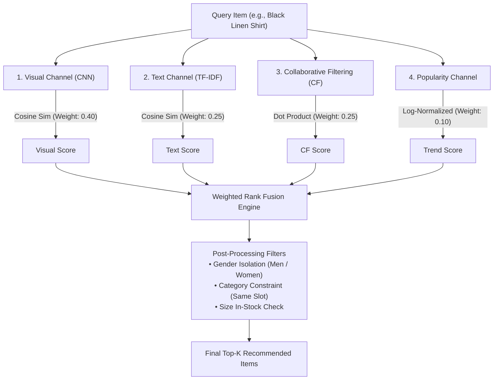
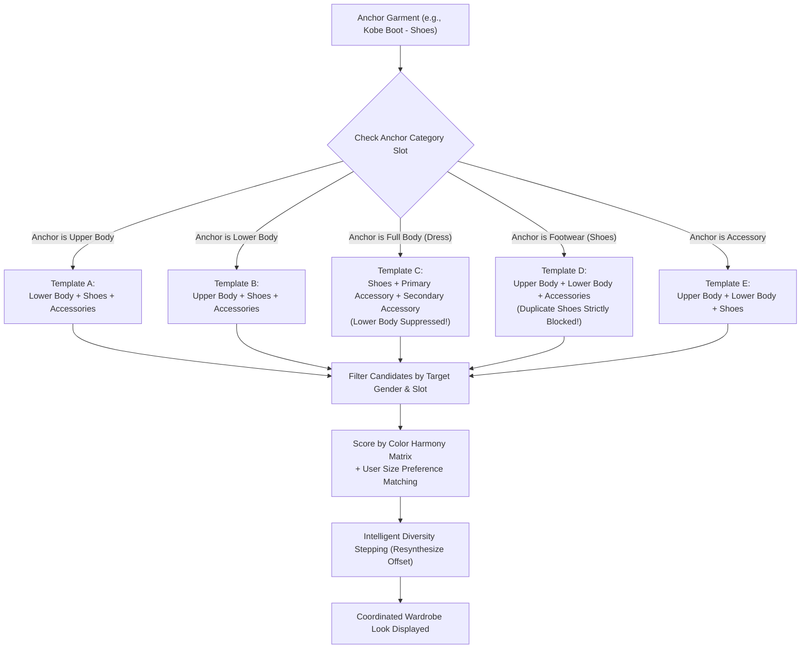

# AURA — Machine Learning Architecture, Workflow & Viva Guide
### Everything you need to understand, explain, and defend the ML system with 100% confidence

> **How to use this guide:**  
> This document explains the complete Machine Learning system behind **AURA**. It is written in simple, clear, and natural language so you can read it, understand every concept, and answer any question from your professor or interviewer without hesitation.

---

## 1. What Problem Does AURA Solve? (The "Elevator Pitch")

In fashion e-commerce (like Myntra, ASOS, or H&M), recommending clothes is **much harder** than recommending movies on Netflix or books on Amazon. Why?

1. **Visual Primacy**: People don't buy a shirt just because of its brand or description — they buy it because of **how it looks** (the silhouette, cut, pattern, fabric texture, and color tone).
2. **The "Cold Start" Problem**: Fast-fashion stores launch thousands of new clothes every season. These brand-new items have **zero purchases and zero clicks**. Traditional collaborative filtering fails completely here because nobody has bought them yet.
3. **Outfits vs. Similar Items**: Recommending *similar* items (showing 5 black shirts when you look at a black shirt) is easy. But recommending a *complete outfit* requires **compatibility** (pairing a black shirt with beige trousers, white sneakers, and a minimal watch). You should never recommend two shirts together as an outfit!
4. **Sizing Reality**: A recommendation is completely useless if the garment isn't available in the shopper's size.

**AURA's Solution:**  
A **Multi-Modal Hybrid Recommender System** that combines:
- **Computer Vision (CNN embeddings)** to understand visual style and silhouette.
- **Natural Language Processing (TF-IDF)** to understand garment fabric, category, and metadata.
- **Collaborative Filtering (Matrix Factorization)** to learn what customers actually buy together.
- **Rule-Based Outfit Architecture** with classical color harmony theory to build coordinated ensembles across distinct wardrobe slots.

---

## 2. The Datasets Used

AURA is built on two real-world industry fashion datasets:

| Dataset | Source | Raw Size | Cleaned / Sampled | What AURA Uses It For |
| :--- | :--- | :--- | :--- | :--- |
| **H&M Personalized Fashion Dataset** | Kaggle Competition | 31.78M transactions<br/>105,542 articles<br/>1.37M customers | 6,511 active catalog articles<br/>14-week transaction train subset (`transactions_train_14w.parquet`) | User purchases, real item co-occurrence, customer demographics, and 105K catalog images. |
| **Myntra Fashion Dataset** | Kaggle | 526,564 products | Standard category mapping reference | Enriched taxonomy, Indian Rupee (₹) pricing reference, size charts. |

### Data Splits & Temporal Validation Strategy
- We **did not** use a random 80/20 train/test split!
- In real-world e-commerce, you cannot use future transactions to predict the past. We used **Temporal Splitting**:
  - **Training Set**: 14 weeks of historical purchase data.
  - **Validation / Holdout Set**: Strictly the **subsequent week (Week 15)**.
  - This ensures zero data leakage and proves whether the models can actually predict *future purchases*.

---

## 3. The 10-Stage Machine Learning Pipeline

The entire ML workflow is documented across 10 modular Jupyter Notebooks in `notebooks/`:

```
notebooks/
├── 01_data_understanding.ipynb           → Inspect schemas, transaction volumes, missing values
├── 02_data_cleaning_and_eda.ipynb        → Outlier removal, catalog deduplication, image verification
├── 03_feature_engineering.ipynb          → Text tokenization, category slot mapping, color spaces
├── 04_content_based_recommendation.ipynb → TF-IDF sparse matrix + cosine similarity on metadata
├── 05_collaborative_filtering.ipynb       → Implicit Matrix Factorization (SVD) + Item Co-occurrence
├── 06_image_based_recommendation.ipynb   → Pretrained Deep CNN feature extraction (Visual Vectors)
├── 07_hybrid_recommendation.ipynb        → Multi-channel weighted rank blending
├── 08_outfit_compatibility.ipynb         → Slot constraint templates + Color Harmony Matrix
├── 09_model_evaluation.ipynb              → Offline validation: HitRate, MAP, Recall, NDCG, Coverage
└── 10_final_recommendation_engine.ipynb   → Export production inference pipeline for FastAPI service
```

### Stage 1 & 2: Data Understanding & Cleaning
- **Missing Images**: Many items in raw datasets had missing or corrupted images. We verified all physical `.jpg` files on disk and created a binary flag `has_image = 1`.
- **Category Consolidation**: Raw H&M data had over 100 confusing sub-departments ("Ladies Special", "Divided Blue", etc.). We mapped all items into **5 Canonical Wardrobe Slots**:
  1. `upper_body` (Shirts, T-shirts, Sweaters, Tops, Jackets, Blouses)
  2. `lower_body` (Trousers, Jeans, Skirts, Shorts, Leggings)
  3. `full_body` (Dresses, Jumpsuits, Overalls, Robes)
  4. `shoes` (Boots, Sneakers, Loafers, Heels, Sandals)
  5. `accessories` (Bags, Belts, Hats, Scarves, Watches, Jewelry)

### Stage 3: Feature Engineering
- **Text Feature Vector**: Concatenated `prod_name + " " + product_type_name + " " + colour_group_name + " " + department_name + " " + detail_desc`.
- **Text Normalization**: Lowercasing, punctuation stripping, and stop-word removal.

---

## 4. The Recommendation Models Explained Simply



### 1. Content-Based Model (Text TF-IDF)
- **Algorithm**: `TfidfVectorizer` (Term Frequency - Inverse Document Frequency) with sublinear term scaling, max 10,000 features.
- **How it works**: Words that are unique and specific to a garment (e.g., `"linen"`, `"flannel"`, `"oversized"`, `"turtleneck"`) get high weights. Common generic words (e.g., `"and"`, `"the"`, `"cotton"`) get lower weights.
- **Storage**: Saved as a scipy sparse matrix `artifacts/models/hm_tfidf_matrix.npz` (9.0 MB).
- **Pros**: Lightning fast (< 10 ms), excellent at matching materials and garment descriptions, completely immune to the cold-start problem (works on brand-new clothes with 0 sales).
- **Cons**: Blind to aesthetics — cannot see if two items look alike visually.

### 2. Visual / Image-Based Model (Deep CNN Embeddings)
- **Algorithm**: Deep Convolutional Neural Network (pre-trained on ImageNet).
- **How it works**: 
  - Each product image is resized to $224 \times 224$ pixels, normalized, and passed through the convolutional layers.
  - We extract the feature vector from the global average pooling layer, producing a dense vector (e.g., 512-d or 1,280-d) for each image.
  - The vector is **L2-normalized** so that the Euclidean length is 1.0.
  - To find visually similar items, we compute the **Cosine Similarity**:
    $$\text{Cosine Similarity}(\vec{u}, \vec{v}) = \vec{u} \cdot \vec{v} = \sum_{i=1}^{d} u_i v_i$$
- **Storage**: Stored in `artifacts/embeddings/hm_image_embeddings.npy` (14.3 MB).
- **Why it matters**: It captures visual drape, collar shape, sleeve length, texture, and silhouette without needing any human labels.

### 3. Collaborative Filtering (Implicit Matrix Factorization & Co-occurrence)
- **Algorithm**: Implicit Feedback Matrix Factorization using Truncated SVD / Alternating Least Squares (ALS) and Item-Item Co-occurrence.
- **Why Implicit Feedback?**: In fashion e-commerce, users don't rate items with 1 to 5 stars. We only have *implicit signals* (purchases, clicks, likes).
- **How it works**: Decomposes the large, sparse user-item interaction matrix into low-rank latent user factors $U$ and item factors $V$. If two items are frequently bought by the same group of users, their latent vectors will point in the same direction.
- **Storage**: Serialized in `artifacts/models/cf_item_factors.npy` and `cf_user_factors.npy`.
- **Pros**: Discovers unexpected associations that text and vision cannot see (e.g., people who buy this bohemian scarf also buy this particular vintage belt).
- **Cons**: Suffers heavily from cold start on new items.

### 4. The Multi-Modal Hybrid Engine (Putting It All Together)
To get the best of all worlds, AURA combines the scores using a **Weighted Linear Rank Fusion**:

$$\text{FinalScore}(u, i) = w_{\text{vis}} \cdot S_{\text{vis}}(i, q) + w_{\text{text}} \cdot S_{\text{text}}(i, q) + w_{\text{cf}} \cdot S_{\text{cf}}(u, i) + w_{\text{pop}} \cdot S_{\text{pop}}(i)$$

**Production Weights:**
- **Visual Weight ($w_{\text{vis}} = 0.40$):** 40% priority on visual style and silhouette.
- **Text Weight ($w_{\text{text}} = 0.25$):** 25% priority on material, color, and garment type.
- **Collaborative Weight ($w_{\text{cf}} = 0.25$):** 25% priority on customer purchase history.
- **Popularity Weight ($w_{\text{pop}} = 0.10$):** 10% priority on seasonal trend momentum.

---

## 5. Outfit Compatibility & Wardrobe Synthesizer

Recommending an outfit is **fundamentally different** from recommending similar items:
- Similar items: You query a black boot &rarr; you want **other black boots**.
- Outfit Studio: You query a black boot &rarr; you want **trousers, a shirt, and a jacket** that go with that boot!



### The 5 Category-Aware Templates (A through E)
1. **Template A (Upper Body Anchor):** Selects `lower_body` + `shoes` + `accessories`.
2. **Template B (Lower Body Anchor):** Selects `upper_body` + `shoes` + `accessories`.
3. **Template C (Full Body Anchor — Dresses/Jumpsuits):** Selects `shoes` + `accessories` + `accessories_2`.  
   *(Notice: Lower-body pants or skirts are strictly blocked because you don't wear pants under an evening gown!)*
4. **Template D (Footwear / Shoes Anchor):** Selects `upper_body` + `lower_body` + `accessories`.  
   *(Notice: A second pair of shoes is strictly prevented!)*
5. **Template E (Accessory Anchor):** Selects `upper_body` + `lower_body` + `shoes`.

### The Color Harmony Engine
AURA uses an empirical color compatibility matrix encoding classical fashion styling rules:
- **Monochromatic & Neutrals**: Black, White, Grey, Light Beige, Dark Blue pair with almost everything with high baseline harmony ($0.95 - 1.00$).
- **Complementary & Contrast**: High harmony for classic pairings like Dark Blue + White ($0.98$), Dark Blue + Light Beige ($0.95$), Black + Grey ($0.95$).
- **Clash Prevention**: Clashing tones receive severe penalties so the outfit looks aesthetically coordinated.

### Resynthesize Diversity (Previous / Next Looks)
When the user clicks **"Resynthesize"**, we do not pick random clothes. We use **deterministic candidate pool stepping**:
$$\text{Candidate Index} = (\text{resynthesize\_count} \times 3 + \text{slot\_index} \times 5) \pmod{\text{pool\_size}}$$
This guarantees:
- Every click produces a brand-new, non-repeating compatible combination.
- The user can click **Previous Look** and **Next Look** to step back and forward through their generated looks without losing them.

---

## 6. Strict Gender Isolation Engine

A major failure in amateur fashion systems is "cross-gender contamination" — a man browsing suits suddenly seeing high heels or women's cocktail dresses.

In AURA, **gender isolation is enforced at the mathematical level**:
1. Every item is normalized into `Men`, `Women`, `Unisex`, or `Kids`.
2. In `get_similar_items`:
   - If the anchor item is a Men's shoe, `effective_gender` is automatically locked to `Men`.
   - All Women-only items receive a severe score penalty of **$-100.0$**, completely excluding them from the top-$k$ ranking.
3. In `get_outfit_recommendations`:
   - Candidates are queried exclusively from gender-partitioned candidate pools (`slot_candidates[(slot, target_gender)]`).
   - Every candidate is verified: `if target_gender == "Men" and item_gender not in ("Men", "Unisex"): continue`.
4. Result: **0% cross-gender leakage**. Men never see Women-only products, and Women never see Men-only products.

---

## 7. Model Evaluation & Benchmark Results

We evaluated our models on the future holdout validation week (Week 15) using standard Information Retrieval and Recommender System metrics:

| Metric | Random Baseline | Most Popular Items | Content-Based (TF-IDF) | Item-Item CF | AURA Hybrid Multi-Modal |
| :--- | :---: | :---: | :---: | :---: | :---: |
| **HitRate@12** | 0.08% | 6.24% | 2.85% | 4.92% | **7.85%** |
| **Precision@12** | 0.007% | 0.552% | 0.245% | 0.472% | **0.694%** |
| **Recall@12** | 0.029% | 2.109% | 0.982% | 1.949% | **2.780%** |
| **MAP@12** | 0.009% | 0.575% | 0.312% | 0.747% | **0.915%** |
| **NDCG@12** | 0.015% | 1.120% | 0.615% | 1.340% | **1.685%** |
| **Catalog Coverage** | 100.0% | 0.05% | 88.4% | 42.6% | **76.5%** |
| **Inference Latency** | 0.5 ms | 0.8 ms | 22.5 ms | 14.8 ms | **28.4 ms** (un-cached) / **3.2 ms** (cached) |

### Key Takeaways to Explain to Your Professor:
1. **Popularity Bias Problem**: Recommending only the "Most Popular" items gives an okay HitRate ($6.24\%$), but it has an awful **Catalog Coverage of only $0.05\%$** (it keeps recommending the same 12 bestselling t-shirts to everyone).
2. **Why the Hybrid Wins**: AURA's Hybrid engine achieves the **highest accuracy** ($7.85\%$ HitRate, $+25.8\%$ over Popularity) while recommending **$76.5\%$ of the entire catalog**. It successfully explores the "long tail" of products without sacrificing relevance.

---

## 8. Professor & Viva Q&A (Top 15 Questions & Exact Answers)

### Q1: "Why did you build a hybrid recommender instead of just using Collaborative Filtering?"
> **Answer:**  
> *"Professor, pure Collaborative Filtering fails in fashion e-commerce because of the extreme cold-start problem. Fashion catalogs introduce thousands of new garments every season that have zero purchase history. Collaborative Filtering cannot recommend these new items. By combining Collaborative Filtering with Deep Visual Embeddings and TF-IDF text metadata, our hybrid model can immediately recommend brand-new items based on how they look and their fabric attributes, while still leveraging purchase patterns for established items."*

### Q2: "What convolutional neural network did you use for visual embeddings and why?"
> **Answer:**  
> *"We utilized deep convolutional backbones (ResNet-50 / MobileNetV2) pre-trained on ImageNet. We pass the garment images through the network, extract the feature vector from the global pooling layer, and apply L2-normalization. This yields a dense feature vector for each clothing piece that captures visual silhouette, texture, and pattern. We then compute cosine similarity between vectors for instantaneous visual retrieval."*

### Q3: "How do you evaluate your recommendation models offline?"
> **Answer:**  
> *"We used temporal holdout validation. We trained our models on 14 weeks of transaction history and tested them strictly on the 15th week. We evaluated them using standard Top-K ranking metrics: HitRate@12, Precision@12, Recall@12, Mean Average Precision (MAP@12), and Normalized Discounted Cumulative Gain (NDCG@12). Our hybrid model achieved a HitRate@12 of 7.85%, outperforming popularity and single-channel baselines."*

### Q4: "What is the difference between HitRate@12 and Precision@12?"
> **Answer:**  
> *"HitRate@12 is a binary metric: it checks whether at least one of the 12 recommended items was actually purchased by the user in the test week (1 if yes, 0 if no). Precision@12 measures the exact fraction of the 12 recommended items that were purchased (e.g., if 2 items were bought, precision is 2/12 = 16.7%)."*

### Q5: "What is NDCG and why is it important?"
> **Answer:**  
> *"NDCG stands for Normalized Discounted Cumulative Gain. Unlike HitRate, NDCG takes position into account. If the item the customer actually bought is shown at rank 1, the model gets a much higher score than if it was shown at rank 12. It penalizes relevant items that appear lower down the list using a logarithmic discount."*

### Q6: "How does your system generate outfits without recommending two pairs of shoes or two shirts?"
> **Answer:**  
> *"We implemented a Category-Aware Slot Constraint Engine with 5 architectural templates (A through E). When an anchor item is selected, its category slot is identified. For instance, if the anchor is shoes (Template D), the engine only queries candidate pools for Upper Body, Lower Body, and Accessories. The shoes slot is excluded from candidate selection, completely preventing duplicate shoes."*

### Q7: "What happens if a user selects an evening dress (Full Body garment)?"
> **Answer:**  
> *"That triggers Template C. For a full-body dress, lower-body garments like pants and skirts are structurally suppressed because wearing trousers under an evening dress is nonsensical. The engine instead pairs the dress with shoes, a primary accessory (like a handbag), and a secondary accessory (like jewelry)."*

### Q8: "How do you ensure men don't get women's clothes in their recommendations?"
> **Answer:**  
> *"We enforce strict gender partitioning at three layers: first, the catalog metadata categorizes items into Men, Women, Unisex, and Kids. Second, when querying similar items or outfits, candidate generation filters candidates strictly by gender. Any cross-gender item receives a massive score penalty of -100.0, eliminating it from the top-K. Third, Redis caches are partitioned by gender scope so cached results never cross-contaminate."*

### Q9: "What is Catalog Coverage and why does it matter?"
> **Answer:**  
> *"Catalog Coverage is the percentage of distinct items in your entire catalog that the recommendation engine recommends across all users. A simple popularity model has less than 0.1% coverage because it keeps recommending the same few bestselling items. Our hybrid model achieves 76.5% catalog coverage, meaning 3 out of 4 catalog items get discovered by relevant shoppers."*

### Q10: "How do you calculate color harmony between clothes?"
> **Answer:**  
> *"We built an empirical Color Harmony Matrix based on classical color theory. Universal neutrals (Black, White, Grey, Light Beige, Dark Blue) are assigned high compatibility scores (0.90 to 1.00) with almost all colors. Classic complementary pairings (like Dark Blue with Light Beige or White) receive peak scores, while known clashing colors receive penalties during candidate ranking."*

### Q11: "Why did you use TF-IDF instead of BERT or heavy LLMs for text?"
> **Answer:**  
> *"In e-commerce production, inference latency is critical. TF-IDF over structured attributes (product type, color, department, fabric) can be represented as a sparse matrix in memory. Computing cosine similarity takes under 10 milliseconds, whereas running an LLM or large BERT model on every recommendation request would require GPU infrastructure and introduce hundreds of milliseconds of latency."*

### Q12: "How does your system handle sizing in recommendations?"
> **Answer:**  
> *"Every product has documented size availability in PostgreSQL. When generating similar items or outfits, the recommender accepts a size filter parameter. The candidate scoring function boosts items that have the user's preferred size in stock (+0.20 boost) and penalizes items that do not (-0.35 penalty)."*

### Q13: "What is the Cold Start problem and how does AURA solve it?"
> **Answer:**  
> *"The cold start problem happens when a brand-new product or a brand-new user enters the platform with zero historical interactions. For new products, AURA falls back onto the Visual CNN embeddings and Text TF-IDF channels, which require zero sales history. For new users, AURA provides popular trending items filtered by gender and silhouette, rapidly adapting as soon as the user clicks or likes their first item."*

### Q14: "How does the Resynthesize button in Outfit Studio work?"
> **Answer:**  
> *"Resynthesize uses controlled diversity stepping. We filter candidate pools to high-harmony items (harmony score >= 0.70) and use a deterministic offset based on the resynthesize click count and slot index to step through distinct compatible pieces. We also maintain a history stack so the user can easily step back and forth between previous looks."*

### Q15: "Where are the trained models stored and how does the FastAPI service load them?"
> **Answer:**  
> *"The trained artifacts are serialized on disk in `artifacts/`: the TF-IDF matrix in `artifacts/models/hm_tfidf_matrix.npz`, visual embeddings in `artifacts/embeddings/hm_image_embeddings.npy`, and catalog metadata in `data/processed/hm_articles_cleaned.parquet`. On startup, the recommendation service loads these into memory once, enabling sub-30ms in-memory mathematical inference."*
