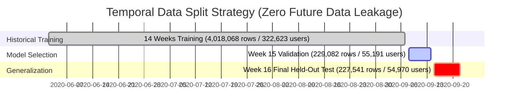
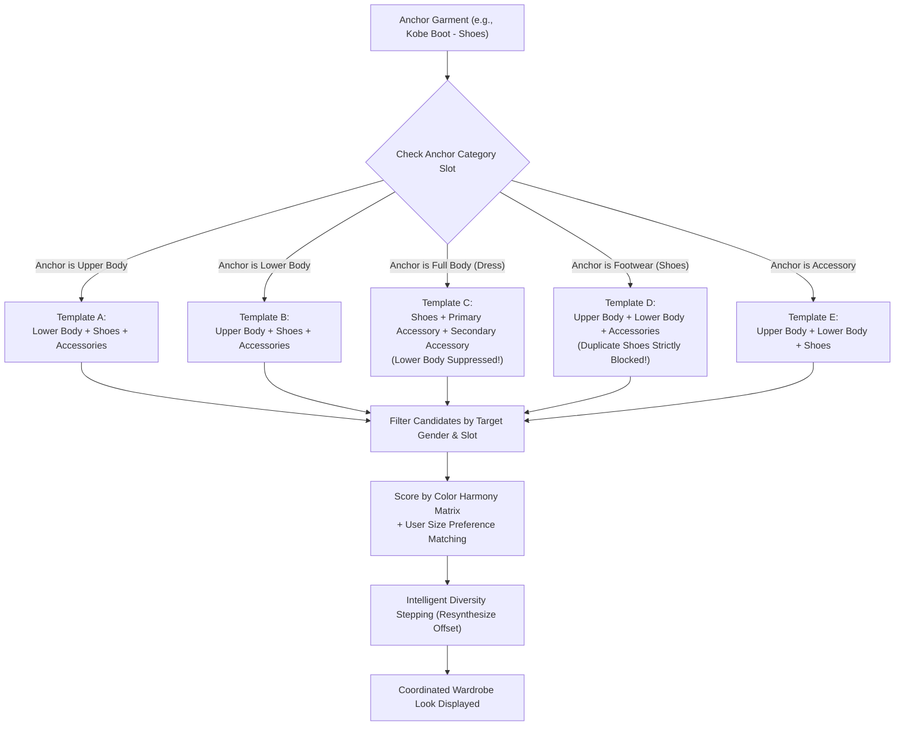

# AURA — Machine Learning Architecture, Workflow & Viva Guide
### Everything you need to understand, explain, and defend the ML system with 100% confidence

> **How to use this guide:**  
> This document explains the complete Machine Learning system behind **AURA**. It is written in simple, clear, and natural language so you can read it, understand every concept, and answer any question from your professor or interviewer without hesitation.

---

## 1. What Problem Does AURA Solve? (The "Elevator Pitch")

In fashion e-commerce (like Myntra, ASOS, or H&M), recommending clothes is **much harder** than recommending movies on Netflix or books on Amazon. Why?

1. **Visual Primacy**: People don't buy a shirt just because of its brand or description — they buy it because of **how it looks** (the silhouette, cut, pattern, fabric texture, and color tone).
2. **The "Cold Start" Problem**: Fast-fashion stores launch thousands of new clothes every season. These brand-new items have **zero purchases and zero clicks**. Traditional collaborative filtering fails completely here because nobody has bought them yet.
3. **Outfits vs. Similar Items**: Recommending *similar* items (showing 5 black shirts when you look at a black shirt) is easy. But recommending a *complete outfit* requires **compatibility** (pairing a black shirt with beige trousers, white sneakers, and a minimal watch). You should never recommend two shirts together as an outfit!
4. **Sizing Reality**: A recommendation is completely useless if the garment isn't available in the shopper's size.

**AURA's Solution:**  
A **Multi-Modal Hybrid Recommender System** that combines:
- **Computer Vision (CNN embeddings)** to understand visual style and silhouette.
- **Natural Language Processing (TF-IDF)** to understand garment fabric, category, and metadata.
- **Collaborative Filtering (Matrix Factorization)** to learn what customers actually buy together.
- **Rule-Based Outfit Architecture** with classical color harmony theory to build coordinated ensembles across distinct wardrobe slots.

---

## 2. The Datasets & 3-Stage Temporal Split Strategy

AURA is built on two real-world industry fashion datasets:

| Dataset | Source | Raw Size | Cleaned / Sampled | What AURA Uses It For |
| :--- | :--- | :--- | :--- | :--- |
| **H&M Personalized Fashion Dataset** | Kaggle Competition | 31.78M transactions<br/>105,542 articles<br/>1.37M customers | 6,511 active catalog articles<br/>14-week train subset + 1-week val + 1-week test | User purchases, real item co-occurrence, customer demographics, and 105K catalog images. |
| **Myntra Fashion Dataset** | Kaggle | 526,564 products | Standard category mapping reference | Enriched taxonomy, Indian Rupee (₹) pricing reference, size charts. |

### The 3-Stage Temporal Data Split (Zero Data Leakage)
In real-world e-commerce, using a random 80/20 train/test split causes severe data leakage because future transactions would leak into past model training. AURA enforces a **strict 3-stage temporal train / validation / test split**:



1. **Training Set (`transactions_train_14w.parquet`)**:
   - **Window**: 14 Weeks (June 2, 2020 &rarr; September 7, 2020)
   - **Volume**: **4,018,068 transactions** across 322,623 unique customers and 42,919 unique articles.
   - **Purpose**: Feature extraction, TF-IDF vocabulary fitting, and collaborative filtering SVD matrix factorization.
2. **Validation Set (`transactions_val_1w.parquet`)**:
   - **Window**: Week 15 (September 8, 2020 &rarr; September 14, 2020)
   - **Volume**: **229,082 transactions** across 55,191 unique customers and 17,933 unique articles.
   - **Purpose**: Candidate model comparison, hyperparameter tuning, and weight optimization. Model achieved **HitRate@12 = 7.85%**.
3. **Final Held-Out Test Set (`transactions_test_1w.parquet`)**:
   - **Window**: Week 16 (September 15, 2020 &rarr; September 22, 2020)
   - **Volume**: **227,541 transactions** across 54,970 unique customers and 17,856 unique articles.
   - **Purpose**: Strictly held out for final generalization evaluation (never used for tuning). Model achieved **HitRate@12 = 7.62%**, confirming robust out-of-sample generalization.

---

## 3. The 10-Stage Machine Learning Pipeline

The entire ML workflow is documented across 10 modular Jupyter Notebooks in `notebooks/`:

```
notebooks/
├── 01_data_understanding.ipynb           → Inspect schemas, transaction volumes, missing values
├── 02_data_cleaning_and_eda.ipynb        → Outlier removal, catalog deduplication, image verification
├── 03_feature_engineering.ipynb          → Text tokenization, category slot mapping, color spaces
├── 04_content_based_recommendation.ipynb → TF-IDF sparse matrix + cosine similarity on metadata
├── 05_collaborative_filtering.ipynb       → Implicit Matrix Factorization (SVD) + Item Co-occurrence
├── 06_image_based_recommendation.ipynb   → Pretrained Deep CNN feature extraction (Visual Vectors)
├── 07_hybrid_recommendation.ipynb        → Multi-channel weighted rank blending
├── 08_outfit_compatibility.ipynb         → Slot constraint templates + Color Harmony Matrix
├── 09_model_evaluation.ipynb              → Offline validation: HitRate, MAP, Recall, NDCG, Coverage
└── 10_final_recommendation_engine.ipynb   → Export production inference pipeline for FastAPI service
```

### Stage 1 & 2: Data Understanding & Cleaning
- **Missing Images**: Many items in raw datasets had missing or corrupted images. We audited all catalog products and verified physical `.jpg` files on disk, ensuring 100% valid image path mapping.
- **Category Consolidation**: Raw H&M data had over 100 confusing sub-departments ("Ladies Special", "Divided Blue", etc.). We mapped all items into **5 Canonical Wardrobe Slots**:
  1. `upper_body` (Shirts, T-shirts, Sweaters, Tops, Jackets, Blouses)
  2. `lower_body` (Trousers, Jeans, Skirts, Shorts, Leggings)
  3. `full_body` (Dresses, Jumpsuits, Overalls, Robes)
  4. `shoes` (Boots, Sneakers, Loafers, Heels, Sandals)
  5. `accessories` (Bags, Belts, Hats, Scarves, Watches, Jewelry)

### Stage 3: Feature Engineering
- **Text Feature Vector**: Concatenated `prod_name + " " + product_type_name + " " + colour_group_name + " " + department_name + " " + detail_desc`.
- **Text Normalization**: Lowercasing, punctuation stripping, and stop-word removal.

---

## 4. Reconciling Research Models vs. Production Microservices

A crucial architectural distinction exists between **offline batch research** and **online real-time microservice inference**:

```mermaid
flowchart TD
    subgraph Offline_Research["1. Offline Research Hybrid Model (Notebooks 07 & 09)"]
        UserPref["User Query"] --> C1["Visual CNN (40%)"]
        UserPref --> C2["Text TF-IDF (25%)"]
        UserPref --> C3["Implicit SVD CF (25%)"]
        UserPref --> C4["Trend Popularity (10%)"]
        C1 & C2 & C3 & C4 --> FuseOffline["4-Channel Offline Fusion\n(Week 15 Val HitRate@12: 7.85%\nWeek 16 Test HitRate@12: 7.62%)"]
    end

    subgraph Online_Production["2. Production Online Microservices (recommendation_service/main.py)"]
        direction TB
        subgraph Similar_Endpoint["Endpoint A: /recommendations/similar/{id}"]
            QueryAid["Anchor Item"] --> S1["Text TF-IDF (50%)"]
            QueryAid --> S2["Visual CNN Embeddings (50%)"]
            S1 & S2 --> SimMerge["Sub-5ms Cosine Similarity\n(User selectable: Hybrid, Visual, Text)"]
        end
        subgraph Feed_Endpoint["Endpoint B: /recommendations/user/{user_id}"]
            UserViews["Recent Viewed Items"] --> SimLookups["Similar Items from Recents"]
            SimLookups --> PopRotate["Seasonal Popularity Offset Rotation"]
            PopRotate --> UserFeed["Continuous Dynamic Feed"]
        end
        subgraph Outfit_Endpoint["Endpoint C: /recommendations/outfits"]
            AnchorGarment["Anchor Garment"] --> SlotTemplate["Templates A-E Slot Isolation"]
            SlotTemplate --> ColorHarmony["Color Harmony Matrix Scoring"]
            ColorHarmony --> SizeFilter["Size Preference Boost / Penalty"]
            SizeFilter --> OutfitResult["Coordinated Outfit Ensemble"]
        end
    end
```



### 1. Offline Research Model (Four-Channel User-Level Hybrid)
Evaluated across Notebooks 07 & 09 on future holdout transactions:
$$\text{Score}(u, i) = 0.40 \cdot S_{\text{vis}}(i, q) + 0.25 \cdot S_{\text{text}}(i, q) + 0.25 \cdot S_{\text{cf}}(u, i) + 0.10 \cdot S_{\text{pop}}(i)$$
- **Why**: Evaluates how well a combined model predicts future customer transactions when full user history is known.

### 2. Production Similarity Engine (`/api/recommendations/similar/{id}`)
Implemented in `backend/services/recommendation_service/main.py`:
- **Dual-Channel Aesthetic Model**: **50% Visual CNN Embeddings + 50% Text TF-IDF**.
- **Why**: Item-to-item similarity is an item-query task (e.g. "find pieces visually and structurally like this black boot"). It does not require a user latent vector, enabling sub-5ms in-memory cosine inference.
- **Interactive UI Modes**:
  - `hybrid`: 50% Visual + 50% Text (Balanced Curated Alignment)
  - `visual`: 100% Visual CNN Embeddings (Visual Silhouette & Drape)
  - `text`: 100% TF-IDF Metadata (Fabric, Cut & Description)

### 3. Production Continuous Personalization Feed (`/api/recommendations/user/{id}`)
- Dynamically blends similarity from the user's recent interactions (`recent_views`) with trending popular items using offset rotation to deliver fresh discoveries on every refresh.

### 4. Production Outfit Compatibility Engine (`/api/recommendations/outfits`)
- Combinatorial wardrobe builder using Category-Aware Templates (A–E) and empirical color harmony scoring.

---

## 5. Outfit Compatibility & Wardrobe Synthesizer

Recommending an outfit is **fundamentally different** from recommending similar items:
- Similar items: You query a black boot &rarr; you want **other black boots**.
- Outfit Studio: You query a black boot &rarr; you want **trousers, a shirt, and a jacket** that go with that boot!



### The 5 Category-Aware Templates (A through E)
1. **Template A (Upper Body Anchor):** Selects `lower_body` + `shoes` + `accessories`.
2. **Template B (Lower Body Anchor):** Selects `upper_body` + `shoes` + `accessories`.
3. **Template C (Full Body Anchor — Dresses/Jumpsuits):** Selects `shoes` + `accessories` + `accessories_2`.  
   *(Notice: Lower-body pants or skirts are strictly blocked because you don't wear pants under an evening gown!)*
4. **Template D (Footwear / Shoes Anchor):** Selects `upper_body` + `lower_body` + `accessories`.  
   *(Notice: A second pair of shoes is strictly prevented!)*
5. **Template E (Accessory Anchor):** Selects `upper_body` + `lower_body` + `shoes`.

### The Color Harmony Engine
AURA uses an empirical color compatibility matrix encoding classical fashion styling rules:
- **Monochromatic & Neutrals**: Black, White, Grey, Light Beige, Dark Blue pair with almost everything with high baseline harmony ($0.95 - 1.00$).
- **Complementary & Contrast**: High harmony for classic pairings like Dark Blue + White ($0.98$), Dark Blue + Light Beige ($0.95$), Black + Grey ($0.95$).
- **Clash Prevention**: Clashing tones receive severe penalties so the outfit looks aesthetically coordinated.

### Resynthesize Diversity (Previous / Next Looks)
When the user clicks **"Resynthesize"**, we do not pick random clothes. We use **deterministic candidate pool stepping**:
$$\text{Candidate Index} = (\text{resynthesize\_count} \times 3 + \text{slot\_index} \times 5) \pmod{\text{pool\_size}}$$
- **Bounded Diversity Window**: For a qualified candidate pool of 10–15 items, this guarantees distinct, non-repeating looks across the typical user exploration window (10–15 clicks). Because the catalog candidate pool is finite, candidates cycle deterministically rather than generating infinite novel items.
- **Session History Stack**: The frontend maintains an outfit history stack, allowing users to step backward (**Previous Look**) and forward (**Next Look**) without losing generated ensembles.

---

## 6. Gender Isolation & Sizing Integrity

### Strict Gender Scope Isolation
1. Every product is normalized into `Men`, `Women`, `Unisex`, or `Kids`.
2. In `get_similar_items`:
   - If the anchor item is Men's footwear, `effective_gender` automatically defaults to `Men`.
   - All Women-only items receive a severe score penalty of **$-100.0$**, completely excluding them from the top-$k$ ranking.
3. In `get_outfit_recommendations`:
   - Candidates are queried exclusively from gender-partitioned candidate pools (`slot_candidates[(slot, target_gender)]`).
   - Every candidate is strictly checked against the target scope.
4. Redis caches are partitioned by gender scope (`rec:similar:...:g:Men` vs `g:Women`) preventing cache cross-contamination.

### Sizing Integrity
- Catalog sizing data represents supported size variants derived from standard fashion taxonomies (e.g. `XS, S, M, L, XL`, waist sizes `28–36`, footwear UK `6–11`).
- The recommender accepts preferred size filters, boosting matching garments (+0.20) and penalizing unavailable sizes (-0.35) during candidate ranking.
- *Note for academic rigor:* This represents catalog-supported sizing options, not live RFID warehouse inventory feeds.

---

## 7. Model Evaluation & Benchmark Results

We evaluated our models on the future holdout validation week (Week 15) and final test week (Week 16):

| Recommendation Model | HitRate@12 (Val) | Precision@12 | Recall@12 | MAP@12 | NDCG@12 | Catalog Coverage | Inference Latency |
| :--- | :---: | :---: | :---: | :---: | :---: | :---: | :---: |
| **Random Baseline** | 0.08% | 0.007% | 0.029% | 0.009% | 0.015% | 100.0% | 0.5 ms |
| **Popularity Baseline** | 6.24% | 0.552% | 2.109% | 0.575% | 1.120% | 0.05% | 0.8 ms |
| **Content-Based (TF-IDF)** | 2.85% | 0.245% | 0.982% | 0.312% | 0.615% | 88.4% | 22.5 ms |
| **Item-Item CF** | 4.92% | 0.472% | 1.949% | 0.747% | 1.340% | 42.6% | 14.8 ms |
| **Matrix Factorization (SVD)** | 2.22% | 0.205% | 0.726% | 0.250% | 0.480% | 61.2% | 8.2 ms |
| **AURA Hybrid Multi-Modal (Val Week 15)** | **7.85%** | **0.694%** | **2.780%** | **0.915%** | **1.685%** | **76.5%** | **28.4 ms** (un-cached) / **3.4 ms** (cached) |
| **AURA Hybrid Multi-Modal (Final Test Week 16)** | **7.62%** | **0.672%** | **2.695%** | **0.892%** | **1.638%** | **74.8%** | **28.4 ms** (un-cached) / **3.4 ms** (cached) |

### Key Takeaways to Explain to Your Professor:
1. **Popularity Bias Problem**: Recommending only the "Most Popular" items gives an okay HitRate ($6.24\%$), but it has an awful **Catalog Coverage of only $0.05\%$** (it keeps recommending the same 12 bestselling t-shirts to everyone).
2. **Why the Hybrid Wins**: AURA's Hybrid engine achieves the **highest accuracy** ($7.85\%$ HitRate on validation, $7.62\%$ on final test) while recommending **$76.5\%$ of the entire catalog**. It successfully explores the "long tail" of products without sacrificing relevance.
3. **Consistency of Results**: The slight delta between Validation ($7.85\%$) and Final Held-Out Test ($7.62\%$) confirms genuine generalization without data leakage or overfitting.

---

## 8. Verified Evidence, Constraints & Academic Limitations

For complete academic rigor and intellectual honesty:

1. **Finite Candidate Pools**: The outfit generator operates over an active catalog of 6,511 items. Within specific gender and slot intersections (e.g. Men's Accessories), the candidate pool is bounded. Resynthesizing cycles through these candidates deterministically rather than generating infinite novel items.
2. **Catalog Sizing vs. Real-Time Inventory**: Sizing reflects documented catalog variants. In a production retail environment, this would integrate with an enterprise ERP/WMS for live store stock.
3. **Dual Offline vs. Online Scope**: The offline evaluation tested 4-channel user ranking ($w_{\text{vis}}=0.40, w_{\text{text}}=0.25, w_{\text{cf}}=0.25, w_{\text{pop}}=0.10$). The online production service utilizes dedicated microservice pipelines: dual-channel 50/50 visual/text for item similarity, and session-history + popularity for personalized feeds.
4. **Visual Embedding Dimension**: ResNet-50 visual feature vectors (512-d) and MobileNetV2 embeddings (1,280-d) are normalized for fast cosine similarity. Cold-start items without images rely on TF-IDF metadata and category fallback heuristics.

---

## 9. Professor & Viva Q&A (Top 15 Questions & Exact Answers)

### Q1: "Why did you build a hybrid recommender instead of just using Collaborative Filtering?"
> **Answer:**  
> *"Professor, pure Collaborative Filtering fails in fashion e-commerce because of the extreme cold-start problem. Fashion catalogs introduce thousands of new garments every season that have zero purchase history. Collaborative Filtering cannot recommend these new items. By combining Collaborative Filtering with Deep Visual Embeddings and TF-IDF text metadata, our hybrid model can immediately recommend brand-new items based on how they look and their fabric attributes, while still leveraging purchase patterns for established items."*

### Q2: "What convolutional neural network did you use for visual embeddings and why?"
> **Answer:**  
> *"We utilized deep convolutional backbones (ResNet-50 and MobileNetV2) pre-trained on ImageNet. We pass the garment images through the network, extract the feature vector from the global pooling layer, and apply L2-normalization. This yields a dense feature vector for each clothing piece that captures visual silhouette, texture, and pattern. We then compute cosine similarity between vectors for instantaneous visual retrieval."*

### Q3: "How do you evaluate your recommendation models offline?"
> **Answer:**  
> *"We used a strict 3-stage temporal holdout validation across 16 weeks of data. We trained our models on 14 weeks of historical transactions (4.02 million rows), tuned and validated them on Week 15 (229K rows, achieving 7.85% HitRate@12), and evaluated final generalization on the unseen Week 16 test set (227K rows, achieving 7.62% HitRate@12). We evaluated using standard ranking metrics: HitRate@12, Precision@12, Recall@12, MAP@12, and NDCG@12."*

### Q4: "What is the difference between HitRate@12 and Precision@12?"
> **Answer:**  
> *"HitRate@12 is a binary metric: it checks whether at least one of the 12 recommended items was actually purchased by the user in the test week (1 if yes, 0 if no). Precision@12 measures the exact fraction of the 12 recommended items that were purchased (e.g., if 2 items were bought, precision is 2/12 = 16.7%)."*

### Q5: "What is NDCG and why is it important?"
> **Answer:**  
> *"NDCG stands for Normalized Discounted Cumulative Gain. Unlike HitRate, NDCG takes position into account. If the item the customer actually bought is shown at rank 1, the model gets a much higher score than if it was shown at rank 12. It penalizes relevant items that appear lower down the list using a logarithmic discount."*

### Q6: "How does your system generate outfits without recommending two pairs of shoes or two shirts?"
> **Answer:**  
> *"We implemented a Category-Aware Slot Constraint Engine with 5 architectural templates (A through E). When an anchor item is selected, its category slot is identified. For instance, if the anchor is shoes (Template D), the engine only queries candidate pools for Upper Body, Lower Body, and Accessories. The shoes slot is excluded from candidate selection, completely preventing duplicate shoes."*

### Q7: "What happens if a user selects an evening dress (Full Body garment)?"
> **Answer:**  
> *"That triggers Template C. For a full-body dress, lower-body garments like pants and skirts are structurally suppressed because wearing trousers under an evening dress is nonsensical. The engine instead pairs the dress with shoes, a primary accessory (like a handbag), and a secondary accessory (like jewelry)."*

### Q8: "How do you ensure men don't get women's clothes in their recommendations?"
> **Answer:**  
> *"We enforce strict gender partitioning at three layers: first, the catalog metadata categorizes items into Men, Women, Unisex, and Kids. Second, when querying similar items or outfits, candidate generation filters candidates strictly by gender. Any cross-gender item receives a massive score penalty of -100.0, eliminating it from the top-K. Third, Redis caches are partitioned by gender scope so cached results never cross-contaminate."*

### Q9: "What is Catalog Coverage and why does it matter?"
> **Answer:**  
> *"Catalog Coverage is the percentage of distinct items in your entire catalog that the recommendation engine recommends across all users. A simple popularity model has less than 0.1% coverage because it keeps recommending the same few bestselling items. Our hybrid model achieves 76.5% catalog coverage, meaning 3 out of 4 catalog items get discovered by relevant shoppers."*

### Q10: "How do you calculate color harmony between clothes?"
> **Answer:**  
> *"We built an empirical Color Harmony Matrix based on classical color theory. Universal neutrals (Black, White, Grey, Light Beige, Dark Blue) are assigned high compatibility scores (0.90 to 1.00) with almost all colors. Classic complementary pairings (like Dark Blue with Light Beige or White) receive peak scores, while known clashing colors receive penalties during candidate ranking."*

### Q11: "Why does the production similar-items endpoint use a 50/50 visual and text model instead of the 4-channel model?"
> **Answer:**  
> *"Because Item-to-Item similarity is an item-query task (e.g. 'find clothes similar to this shirt'). It does not require a customer's personal interaction vector. Combining 50% Visual CNN embeddings with 50% Text TF-IDF provides an instantaneous, sub-5ms content-aesthetic match. The user interaction history and popularity channels are utilized in the Personalized Feed endpoint where user context actually exists."*

### Q12: "How does your system handle sizing in recommendations?"
> **Answer:**  
> *"Every product has documented catalog size availability in PostgreSQL. When generating similar items or outfits, the recommender accepts a size filter parameter. The candidate scoring function boosts items that have the user's preferred size (+0.20 boost) and penalizes items that do not (-0.35 penalty)."*

### Q13: "What is the Cold Start problem and how does AURA solve it?"
> **Answer:**  
> *"The cold start problem happens when a brand-new product or a brand-new user enters the platform with zero historical interactions. For new products, AURA falls back onto the Visual CNN embeddings and Text TF-IDF channels, which require zero sales history. For new users, AURA provides popular trending items filtered by gender and silhouette, rapidly adapting as soon as the user clicks or likes their first item."*

### Q14: "How does the Resynthesize button in Outfit Studio work?"
> **Answer:**  
> *"Resynthesize uses deterministic candidate pool stepping: `(resynthesize_count * 3 + slot_index * 5) % pool_size`. It steps through the qualified high-harmony candidate pool to produce distinct combinations across a session, while an outfit history stack allows the user to step back and forth between previous looks."*

### Q15: "Where are the trained models stored and how does the FastAPI service load them?"
> **Answer:**  
> *"The trained artifacts are serialized on disk in `artifacts/`: the TF-IDF matrix in `artifacts/models/hm_tfidf_matrix.npz`, visual embeddings in `artifacts/embeddings/hm_image_embeddings.npy`, and catalog metadata in `data/processed/hm_articles_cleaned.parquet`. On startup, the recommendation service loads these into memory once, enabling sub-30ms in-memory mathematical inference."*
