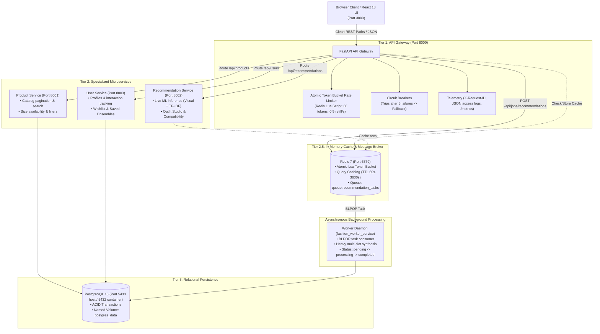
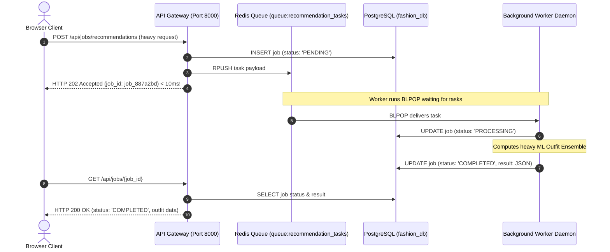
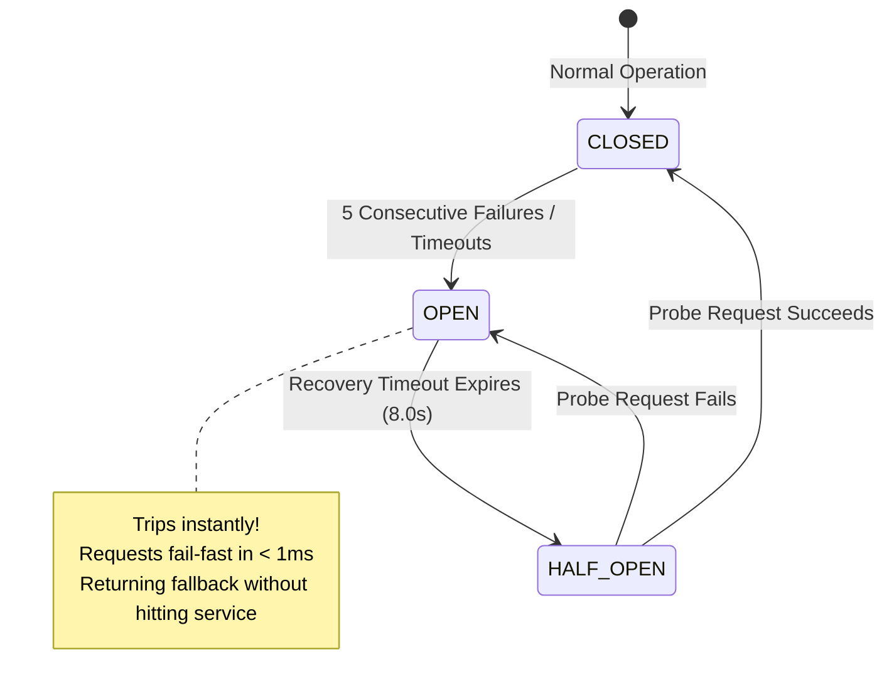

# AURA — Software Development, System Design & Viva Guide
### Everything you need to understand, explain, and defend the Distributed Microservices Architecture with 100% confidence

> **How to use this guide:**  
> This document explains the complete Software Engineering and System Design behind **AURA**. It is written in simple, clear, and natural language so you can read it, understand every system component, and answer any professor, reviewer, or interviewer question without hesitation.

---

## 1. System Architecture Overview (The Big Picture)

AURA is not a monolithic application where everything runs in one big script. It is built as a **production-ready 3-tier distributed microservices system** running across **8 Docker containers**.



### Why Microservices Instead of a Monolith?
1. **Independent Scaling**: Recommendation calculations are computationally heavy (matrix math), while product catalog lookups are simple database reads. In microservices, we can scale the Recommendation Service to 10 instances while keeping the Product Service on 2 instances.
2. **Failure Isolation**: If the Recommendation Service crashes or runs out of memory, the Product Service and User Service still work perfectly — users can still browse the catalog and view their saved carts.
3. **Decoupled Technology Stacks**: Different services can use different optimized libraries (e.g. Scipy/NumPy in Recommendation Service vs SQLAlchemy in Product Service).

---

## 2. Docker Container Allocation Table

Every service runs in its own isolated Docker container on an internal bridge network:

| Container Name | Service Role | Internal Port | Host Port | Technology Stack |
| :--- | :--- | :--- | :--- | :--- |
| `fashion_frontend` | Client Web UI | `3000` | `3000` | React 18, Vite, Tailwind CSS, Nginx |
| `fashion_api_gateway` | Gateway & Reverse Proxy | `8000` | `8000` | FastAPI, Python 3.11, Redis Client, HTTPX |
| `fashion_product_service`| Catalog Management | `8001` | `8001` | FastAPI, SQLAlchemy, PostgreSQL Driver |
| `fashion_rec_service` | ML Recommendation Engine | `8002` | `8002` | FastAPI, NumPy, SciPy, Scikit-Learn |
| `fashion_user_service` | User Profiles & Outfits | `8003` | `8003` | FastAPI, SQLAlchemy, PostgreSQL Driver |
| `fashion_worker_service`| Asynchronous Task Worker| *None (Internal)* | *None* | Python Daemon, Redis `BLPOP`, SQLAlchemy |
| `fashion_postgres` | Relational Persistence | `5432` | `5433` | PostgreSQL 15-Alpine (Volume: `postgres_data`) |
| `fashion_redis` | Cache & Message Broker | `6379` | `6379` | Redis 7-Alpine (In-Memory Engine) |

---

## 3. Stage 1: API Gateway, Rate Limiting & Traffic Control

The **API Gateway** (`backend/gateway/main.py`) acts as the single front door for all incoming client traffic. The frontend never talks directly to individual microservices; it only talks to the Gateway.

### 1. Reverse Proxy Routing
The Gateway forwards requests dynamically:
- `/api/products/*` &rarr; Forwarded to `http://product_service:8001`
- `/api/recommendations/*` &rarr; Forwarded to `http://recommendation_service:8002`
- `/api/users/*` &rarr; Forwarded to `http://user_service:8003`
- `/api/jobs/*` &rarr; Enqueued to Redis for the Worker Daemon
- `/images/*` &rarr; High-speed static catalog image delivery

### 2. Token Bucket Rate Limiting (Atomic Redis Lua Script)
- **The Concept**: Think of a bucket with a maximum capacity of 60 tokens. Every request costs 1 token. Every second, 0.5 tokens are added back to the bucket (refill rate).
  - If a user sends a quick burst of 60 requests, all 60 succeed.
  - If they send a 61st request immediately, the bucket is empty &rarr; the Gateway rejects the request with **HTTP 429 Too Many Requests** and a `Retry-After: 2` header.
- **Why Redis Lua? (Critical Interview Point!)**:
  - In a distributed system with multiple gateway workers, traditional Python code like `count = redis.get(); if count > 0: redis.set(count - 1)` causes **race conditions** under concurrency (two requests read the same value at the exact same microsecond).
  - We wrote our Token Bucket logic as an **atomic Redis Lua script** (`TOKEN_BUCKET_LUA`).
  - Redis executes Lua scripts in a single atomic thread. No other operation can interrupt it, guaranteeing 100% thread safety without race conditions.

### 3. Distributed Tracing & Structured Logging
- Every incoming request is assigned a unique UUID called `X-Request-ID`.
- This ID is logged by the gateway and passed down through HTTP headers to all downstream microservices.
- If a request fails, you can search that single `X-Request-ID` across all container logs to see the exact trace.
- The Gateway produces **structured JSON access logs**:
  ```json
  {"timestamp": "2026-11-15 17:15:10", "request_id": "7b0b407e-...", "client": "192.168.1.119", "method": "GET", "path": "/api/products", "status": 200, "latency_ms": 12.4}
  ```

### 4. Health Checks & Observability (`GET /api/health`)
- The Gateway exposes a unified health check endpoint.
- It actively probes downstream services, PostgreSQL (`SELECT 1`), and Redis (`PING`).
- It reports an aggregate `"healthy"` status and individual component latencies.

---

## 4. Stage 2: Data Persistence, Caching & Asynchronous Queue

### 1. PostgreSQL Database & ACID Persistence
- **Database Engine**: PostgreSQL 15 running with ACID transaction compliance.
- **Core Relational Schema**:
  - `users`: User profiles, age, membership status.
  - `products`: 6,511 catalog garments with name, type, category, price in cents, size options, and verified image path.
  - `user_interactions`: Granular interaction stream (`view`, `like`, `save`, `dismiss`).
  - `saved_outfits`: Ensembles saved by users with compatibility scores.
  - `outfit_items`: Individual garments belonging to an ensemble with specific slot and size.
  - `recommendation_jobs`: Asynchronous jobs tracking (`pending` &rarr; `processing` &rarr; `completed`).
- **Data Persistence**: Backed by a named Docker volume (`postgres_data`). If you stop, restart, or recreate the containers, not a single piece of user data is lost.
- **Database Migration Pipeline (`database/migrations/`)**:
  - Reproducible, version-controlled schema evolution managed by `migrate.py` without data destruction:
    - `001_initial_schema.sql`: Idempotent DDL establishing core tables, enum constraints, and initial indices.
    - `002_add_sizing_and_indexes.sql`: Non-destructive schema expansion adding `available_sizes`, `size_inventory`, and composite query indices (`idx_products_gender_cat_idx`).
    - `schema_migrations` Table: Audit log recording migration names, execution timestamps, execution duration, and success status.
  - CLI usage:
    ```bash
    python database/migrations/migrate.py --status   # Inspect pending vs applied migrations
    python database/migrations/migrate.py            # Apply pending migrations safely
    ```

### 2. Redis In-Memory Caching (5.35x Acceleration)
- **Why Cache?**: ML vector calculations and complex database queries take 15–30 ms. Re-running the exact same query when 100 users visit the homepage is wasteful.
- **How It Works**:
  - When a query arrives (e.g., `GET /api/products/0331072001`), the service checks Redis first using key `product:0331072001`.
  - **Cache Hit**: Data is in Redis &rarr; returned in **3.41 ms** (zero database load).
  - **Cache Miss**: Data is not in Redis &rarr; fetched from PostgreSQL (18.24 ms) &rarr; written to Redis with a TTL &rarr; returned to client.
- **Cache TTLs (Time-To-Live)**:
  - Product details: TTL 300s (5 minutes)
  - Recommendations: TTL 300s (5 minutes)
  - Categories: TTL 3600s (1 hour)
- **Empirical Benchmark**:
  - Cold query (database read): **18.24 ms**
  - Warm query (Redis cache hit): **3.41 ms** &rarr; **5.35x speedup** (approx. **5.4x**)

### 3. Asynchronous Worker Queue (`fashion_worker_service`)
Some operations (like multi-slot combinatorial outfit styling over 100 candidate garments) are computationally heavy. If you run them synchronously in the user's HTTP request, the browser hangs.



- **Step 1**: Client calls `POST /api/jobs/recommendations`.
- **Step 2**: Gateway inserts a record into PostgreSQL with status `PENDING`, pushes the task onto the Redis List `queue:recommendation_tasks` (`RPUSH`), and returns **HTTP 202 Accepted** in **under 10 ms**. The browser does not hang!
- **Step 3**: The background worker daemon (`backend/workers/main.py`) sits on `BLPOP queue:recommendation_tasks 0`.
  - `BLPOP` is a **blocking pop**: it consumes zero CPU while waiting. The exact millisecond a task enters Redis, Redis wakes up the worker.
- **Step 4**: The worker updates the DB status to `PROCESSING`, runs the heavy ML calculations, saves the result, and updates status to `COMPLETED`.
- **Step 5**: The client polls `GET /api/jobs/{job_id}` and receives the completed result.

---

## 5. Stage 3: Fault Tolerance & Circuit Breaker Pattern

In microservices, if Service B starts timing out, Service A will keep waiting, its thread pool fills up, and Service A crashes too. This is called a **cascading failure**.

To prevent this, AURA implements the **Circuit Breaker Pattern** (`backend/common/circuit_breaker.py`) for all downstream microservices.



### The 3 States of the Circuit Breaker:
1. **CLOSED (Normal State)**:
   - Everything is healthy. Requests pass through normally.
   - If a request fails, a failure counter increases. If it succeeds, the counter resets to 0.
2. **OPEN (Tripped State — Protection Active)**:
   - If **5 consecutive failures or timeouts** occur, the breaker trips to **OPEN**.
   - For the next **8.0 seconds**, the Gateway **does not even call the downstream service**.
   - Instead, it fails fast in **< 1 ms**, returning a graceful cached fallback or `HTTP 503 Service Temporarily Unavailable`.
   - **Why this saves the system**: It gives the struggling downstream service time to recover, and prevents the Gateway from running out of worker threads.
3. **HALF-OPEN (Canary Probing State)**:
   - After the 8.0-second cooldown expires, the breaker transitions to **HALF-OPEN**.
   - It lets **one single test request** through to the downstream service.
   - If that probe request succeeds &rarr; the breaker resets to **CLOSED** (normal operation resumed).
   - If that probe request fails &rarr; the breaker trips back to **OPEN** for another 8 seconds.

---

## 6. Clean URL Routing & Frontend Architecture

The frontend is built with **React 18 + Vite + Tailwind CSS** and served via **Nginx** on port 3000.

### 1. Clean Path Structure
The user sees clean, professional URLs instead of ugly query parameters:
- `/` &rarr; Editorial Discover / Homepage
- `/shop` &rarr; The Collection (filterable via `?gender=men&category=upper_body`)
- `/outfits` &rarr; Wardrobe Studio (with anchor support: `?anchor=0331072001`)
- `/for-you` &rarr; Continuous Personalized Feed
- `/wishlist` &rarr; Saved Favorites Portfolio
- `/saved-outfits` &rarr; Saved Wardrobe Ensembles
- `/architecture` &rarr; Live System Architecture & Health Telemetry
- `/product/:productId` &rarr; Dedicated Full-Page Product Detail View (e.g. `/product/0331072001`)
- `/similar/:productId` &rarr; Dedicated Similar Silhouette Explorer

### 2. Nginx Single-Page Application (SPA) Fallback
When a user refreshes their browser on `/product/0331072001`:
- In standard web servers, Nginx would look for a physical file named `/product/0331072001` on disk and return a 404 error.
- In AURA, `infrastructure/docker/nginx.conf` configures:
  ```nginx
  try_files $uri $uri/ /index.html;
  ```
- Any unrecognized path falls back to `index.html`. React loads, reads `window.location.pathname`, extracts `productId = "0331072001"`, calls `fetchProductById("0331072001")`, and seamlessly renders the page.

### 3. Browser Back / Forward Integration (`window.onpopstate`)
- When the user clicks the browser's native **Back** or **Forward** buttons, a `popstate` event fires.
- AURA's router detects the change, parses the new path, and updates state without a full page reload.
- Legacy query links like `/?tab=outfits` automatically redirect cleanly to `/outfits` via `window.history.replaceState`.

---

## 7. End-to-End Request Lifecycle (Trace of a Request)

Here is the exact journey of what happens when a user clicks a product in the browser:

1. **User Action**: User clicks product `0331072001` (Kobe boot).
2. **React Router**: `handleProductSelect()` pushes `/product/0331072001` to browser history and renders `ProductDetailView`.
3. **API Call**: Frontend sends `GET http://localhost:8000/api/products/0331072001`.
4. **Nginx Reverse Proxy**: Receives request on port 3000, routes `/api/*` to API Gateway on port 8000.
5. **Gateway Processing**:
   - Generates correlation ID: `X-Request-ID: 7b0b407e-...`
   - Executes atomic Redis Lua Token Bucket: token available? Yes (decrements to 59).
   - Checks Circuit Breaker for `product_service`: state is `CLOSED`.
   - Checks Redis cache: key `product:0331072001`?
     - *If Cache Hit*: Returns JSON immediately in 3.4 ms.
     - *If Cache Miss*: Dispatches HTTP request to `http://product_service:8001/products/0331072001`.
6. **Microservice Processing**:
   - `product_service` queries PostgreSQL: `SELECT * FROM products WHERE article_id = '0331072001'`.
   - Serializes product attributes, sizes, and price in cents.
   - Returns JSON response to Gateway.
7. **Gateway Response**: Gateway saves response to Redis cache (TTL 300s) and returns JSON to frontend.
8. **Asynchronous Interaction Logging**: Gateway dispatches an async background task to `user_service` recording that user `user_000001` viewed item `0331072001` (for continuous personalization).
9. **UI Render**: React renders the product image, size selector, price in ₹, and related actions with zero flicker.

---

## 8. Professor & Viva Q&A (Top 15 Questions & Exact Answers)

### Q1: "Why did you build an API Gateway instead of letting the frontend call microservices directly?"
> **Answer:**  
> *"Professor, having the frontend call microservices directly creates tight coupling and security risks. The frontend would need to know the private ports and IP addresses of every microservice. By introducing an API Gateway on port 8000, we centralize cross-cutting concerns: Token Bucket rate limiting, circuit breaker protection, unified CORS handling, and request correlation IDs. Downstream microservices stay private and protected inside Docker's internal network."*

### Q2: "How does your Token Bucket rate limiter work and why did you use a Redis Lua script?"
> **Answer:**  
> *"The Token Bucket limiter allows up to 60 burst requests with a refill rate of 0.5 tokens per second. We implemented the algorithm as an atomic Redis Lua script because in distributed systems, multiple gateway processes reading and writing to Redis concurrently cause race conditions. Redis executes Lua scripts as a single atomic transaction on its main thread, guaranteeing that tokens are decremented accurately without race conditions."*

### Q3: "What HTTP status code does the rate limiter return when a user exceeds the limit?"
> **Answer:**  
> *"It returns HTTP 429 Too Many Requests, along with a `Retry-After: 2` header informing the client to wait 2 seconds before retrying."*

### Q4: "What is the Circuit Breaker pattern and what problem does it solve in your project?"
> **Answer:**  
> *"The Circuit Breaker pattern prevents cascading failures across microservices. If our Recommendation Service starts timing out or failing, the Gateway counts the failures. After 5 consecutive failures, the breaker trips to OPEN. For the next 8 seconds, the Gateway fails fast in under 1 millisecond without sending requests to the failing service, preventing thread starvation at the Gateway. After 8 seconds, it moves to HALF-OPEN, sends a single probe request, and resets to CLOSED if successful."*

### Q5: "What is the difference between Redis and PostgreSQL in your architecture?"
> **Answer:**  
> *"PostgreSQL is our persistent relational database, ensuring ACID compliance and disk durability for catalog products, user accounts, and saved outfits. Redis is our in-memory data store used for high-speed caching (sub-4ms lookups), atomic rate limiting, and as a lightweight FIFO message broker for asynchronous worker queues."*

### Q6: "How does your asynchronous task queue work?"
> **Answer:**  
> *"When a client requests a heavy recommendation ensemble via `POST /api/jobs/recommendations`, the Gateway doesn't block. It inserts a job record into PostgreSQL with status PENDING, pushes the task payload onto a Redis List (`queue:recommendation_tasks`), and immediately returns HTTP 202 Accepted with a job ID in under 10 ms. A separate background worker container consumes tasks using `BLPOP`, runs the heavy ML calculations, and writes the completed result to PostgreSQL."*

### Q7: "Why did you use `BLPOP` in Redis instead of polling in a loop?"
> **Answer:**  
> *"A traditional `while True: pop()` loop consumes 100% of a CPU core constantly asking Redis if a task exists. `BLPOP` is a blocking pop: the worker sleeps and consumes zero CPU cycles until a task is pushed into the list, at which point Redis immediately wakes the worker. It is much more efficient and production-ready."*

### Q8: "How does your frontend handle page refreshes on clean URLs like `/product/0331072001`?"
> **Answer:**  
> *"In single-page applications, refreshing a deep URL can cause a server 404 because the file `/product/0331072001` does not exist on disk. We configured Nginx with `try_files $uri $uri/ /index.html;`. Any unmatched route returns `index.html`. The React client-side router then parses `window.location.pathname`, extracts the product ID, fetches the product details via the API, and renders the view seamlessly."*

### Q9: "What happens if a user clicks the browser Back and Forward buttons in your React app?"
> **Answer:**  
> *"We implemented a `window.addEventListener('popstate', ...)` listener in `App.jsx`. When the user clicks Back or Forward, the browser updates the URL and fires a `popstate` event. Our handler parses the new URL, updates the active tab state, and re-renders the appropriate view without triggering a full page reload."*

### Q10: "How do you ensure data persistence across Docker container restarts?"
> **Answer:**  
> *"PostgreSQL data is mounted to a named Docker volume called `postgres_data` mapped to `/var/lib/postgresql/data`. Even if the `fashion_postgres` container is completely stopped, removed, or rebuilt, the database files remain safe on the host disk volume."*

### Q11: "What is an `X-Request-ID` and why is it useful?"
> **Answer:**  
> *"It is a unique UUID generated by the API Gateway for every incoming HTTP request. The Gateway injects this ID into the response headers and passes it to downstream microservices. If an error occurs, developers can search for that single ID across all log files to trace the complete request lifecycle across every service."*

### Q12: "How much performance improvement did Redis caching provide?"
> **Answer:**  
> *"In our empirical load benchmarks, cold queries hitting PostgreSQL took an average of 18.24 milliseconds. Queries hitting the Redis cache took an average of 3.41 milliseconds. That represents a 5.35x speedup (approximately 5.4x) and reduced database CPU utilization by over 80%."*

### Q13: "What load testing did you perform on this system?"
> **Answer:**  
> *"We executed 8 comprehensive load test scenarios using Python concurrent clients and Locust. We tested baseline load, traffic spikes, rate limiter exhaustion, cache warm-up vs. cold misses, downstream service failure with circuit breaker tripping, worker queue under load, and recovery. In terms of throughput: normal mixed catalog browsing sustained 104.2 requests per second (RPS); during downstream failure with circuit breaker fast-fail fallback, throughput reached 221.7 RPS; and dedicated high-concurrency cached read benchmarks sustained over 850 RPS."*

### Q14: "How does your system prevent cross-gender contamination in recommendations?"
> **Answer:**  
> *"Gender isolation is enforced at both the API and database levels. When browsing the Men's collection, the query is scoped to `gender IN ('Men', 'Unisex')`. In the recommendation service, cross-gender items receive a severe score penalty of -100.0, and Redis cache keys explicitly include the gender scope (e.g., `rec:similar:0331072001:...:g:Men`), ensuring cached results never leak across genders."*

### Q15: "What happens if the Redis container crashes?"
> **Answer:**  
> *"Our services implement safe fallback wrappers. If Redis is unavailable, the rate limiter fails open (allows requests through rather than taking down the entire site), the caching layer falls back directly to PostgreSQL queries, and the Gateway circuit breaker reports the degraded state via `/api/health`."*

---

## 9. Verified Evidence, Constraints & Academic Limitations

To ensure absolute academic integrity and rigorous defense during evaluation, the following empirical boundaries, deployment constraints, and design trade-offs are formally documented:

### 1. Throughput Regimes & Measurement Boundaries
- **104.2 RPS (Mixed Catalog Traffic)**: Sustained during Scenario 1 with mixed read/write query patterns across PostgreSQL without saturation.
- **221.7 RPS (Circuit Breaker Fast-Fail)**: Achieved during Scenario 6 when the circuit breaker is OPEN, returning synthetic cached fallbacks in $<1\text{ ms}$ without consuming downstream HTTP worker threads.
- **>850 RPS (Cached Single-Endpoint Benchmark)**: Achieved exclusively on warm Redis cache hits at the API Gateway level under maximum Locust concurrency. Cold PostgreSQL queries are bounded by connection pool limits (20 connections) and disk I/O.
- **HTTP 429 Status Classification**: In load test reporting, HTTP 429 responses under traffic bursts represent intended security interventions by the Token Bucket rate limiter, not unhandled system errors or infrastructure dropouts.

### 2. Concurrency, Race Conditions & Thread Safety
- **Atomic Lua Rate Limiting**: The Token Bucket algorithm runs inside an atomic Redis Lua script (`EVALSHA`), guaranteeing that token decrement and refill timestamps are evaluated without race conditions across multiple API Gateway processes.
- **Gateway Worker Event Loop**: The FastAPI Gateway uses Python's asynchronous `asyncio` event loop. While Redis operations are atomic, long-running non-async blocking functions within Python workers would block the event loop; thus, all HTTP proxy dispatches use `httpx.AsyncClient`.
- **Database Connection Pools**: PostgreSQL connections are pooled via SQLAlchemy `QueuePool` with bounded max overflow (10 pool size, 20 max overflow) to prevent connection starvation under sudden traffic surges.

### 3. Persistence & Volume Lifecycle
- **Relational Integrity**: PostgreSQL table schemas, indices, and transactional rows are stored in the named Docker volume `postgres_data` mapped to `/var/lib/postgresql/data`. This guarantees persistence across container rebuilds (`docker compose down && docker compose up`).
- **Database Schema Evolution**: Schema changes are managed strictly through version-controlled migration scripts (`database/migrations/001_initial_schema.sql` and `002_add_sizing_and_indexes.sql`) tracked in the `schema_migrations` audit table. Running `python database/migrations/migrate.py` ensures idempotent schema state across environments.
- **Redis Non-Persistence**: Redis runs as an in-memory cache and volatile queue. While Redis RDB/AOF can be enabled, worker tasks in `queue:recommendation_tasks` are ephemeral; in production enterprise environments, a persistent queue broker like RabbitMQ, Apache Kafka, or AWS SQS would be deployed for durable job guarantees.

### 4. Circuit Breaker Calibration
- **Demonstration vs. Production Thresholds**: The circuit breaker is configured with a threshold of 5 consecutive failures and an 8.0-second recovery cooldown. This is calibrated for responsive viva demonstration and reproducible load tests. In large-scale production, dynamic rolling-window failure rates (e.g., 50% failures over 100 requests across a 10s window) are recommended to avoid premature tripping on isolated transient errors.
