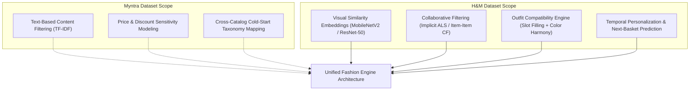

# Stage 0: Comprehensive Dataset Audit & Sampling Strategy Report

**Project**: Intelligent AI Fashion Recommendation System  
**Date**: November 2026  
**Status**: Stage 0 Completed & Verified  

---

## 1. Executive Summary

This report establishes the verified empirical baseline for both available datasets: **Myntra Fashion Clothing** and **H&M Personalized Fashion Recommendations**. Every metric, row count, null percentage, and distribution curve in this document was calculated directly from the raw files on disk.

### Key Empirical Findings:
1. **H&M Image Coverage**: Exactly **105,100 of 105,542 articles (99.58%)** have verified, high-resolution `.jpg` images on disk located across `images/010/` to `images/095/`. Filenames directly map to 10-digit zero-padded article IDs (`0{article_id}.jpg`).
2. **Transaction Date Coverage**: The H&M transaction log spans **2018-09-20 to 2020-09-22** (733 days / 24 months), containing **31,788,324 purchase events**.
3. **Transaction Window & Density Analysis**:
   - The **16-week window** (2020-06-02 to 2020-09-22) preserves **4,474,691 interactions** across **44,989 unique products** (under a threshold of $\ge 5$ interactions).
   - This expands catalog item coverage by **+13.5%** over the 12-week window (44,989 items vs. 39,624 items) while maintaining an optimal RAM footprint of only **~530 MB**, well within our 16 GB machine ceiling.
4. **Myntra Data Characteristics**: Contains **526,564 products** across 13 columns. No local images exist (only external product-page URLs), and no user interactions exist. Missing rates: 36.68% for `DiscountPrice` and 63.84% for `Ratings`.

---

## 2. Dataset Dimensions & Schema Audit

### A. Myntra Dataset (`archive/Myntra Fasion Clothing.csv`)
* **Total Records**: 526,564 rows
* **Total Columns**: 13 columns
* **Unique Product IDs**: 526,564 (Zero duplicates, 100% unique primary key)
* **File Size**: ~130.6 MB

| Column Name | Inferred Type | Null Count | Null % | Description & Quality Notes |
| :--- | :--- | :--- | :--- | :--- |
| `URL` | string | 0 | 0.00% | Webpage URL (not direct image link). Do not scrape. |
| `Product_id` | integer | 0 | 0.00% | Unique product identifier. |
| `BrandName` | string | 0 | 0.00% | Brand (Top: Pothys 16,005; Roadster 10,935; KALINI 9,589). |
| `Category` | string | 0 | 0.00% | Broad category (Top: Indian Wear 145,845; Western 140,992). |
| `Individual_category` | string | 0 | 0.00% | Fine-grained category (e.g. kurtas, sarees, t-shirts, jeans). |
| `category_by_Gender` | string | 0 | 0.00% | Gender target: Women (339,185, 64.4%) vs Men (187,379, 35.6%). |
| `Description` | string | 0 | 0.00% | Textual product description for NLP and TF-IDF extraction. |
| `DiscountPrice (in Rs)` | float | 193,158 | **36.68%** | Missing when items are sold at full retail price (0% discount). |
| `OriginalPrice (in Rs)` | float | 0 | 0.00% | Retail price. Mean: ₹2,414.07, Median: ₹1,999.00. |
| `DiscountOffer` | string | 74,306 | 14.11% | Promotional text (e.g., "50% OFF", "Buy 1 Get 1"). |
| `SizeOption` | string | 0 | 0.00% | Available sizes (e.g., "S, M, L, XL"). |
| `Ratings` | float | 336,152 | **63.84%** | Average customer star rating (1.0 to 5.0). Long-tail sparse. |
| `Reviews` | float | 336,152 | **63.84%** | Number of customer reviews. Aligns exactly with Ratings. |

---

### B. H&M Catalog (`h-and-m.../articles.csv`)
* **Total Articles**: 105,542 rows
* **Total Columns**: 25 columns
* **Unique Article IDs**: 105,542 (Zero duplicates)
* **File Size**: ~36.1 MB

| Column Hierarchy | Key Unique Values | Distribution / Dominant Values |
| :--- | :--- | :--- |
| `product_group_name` | 19 groups | **Garment Upper body**: 42,741 (40.5%) **Garment Lower body**: 19,812 (18.8%) **Garment Full body**: 13,292 (12.6%) **Accessories**: 11,158 (10.6%) **Underwear**: 5,490 (5.2%) **Shoes**: 5,283 (5.0%) |
| `product_type_name` | 131 types | Trousers (11,169), Dress (10,362), Sweater (9,302), T-shirt (7,904), Top (4,155), Blouse (3,979), Jacket (3,940), Shorts (3,939), Shirt (3,405). |
| `colour_group_name` | 50 color groups | Black (22,670), Dark Blue (12,171), White (9,542), Light Pink (5,811), Grey (4,487), Light Beige (3,356), Blue (3,308), Red (3,056). |
| `perceived_colour_value_name` | 8 shades | Dark (42,706), Light (15,739), Dusty Light (22,152), Medium Dusty (12,634). |
| `index_group_name` | 5 customer groups | Ladieswear (39,737), Baby/Children (34,711), Divided (15,149), Menswear (12,553), Sport (3,392). |
| `detail_desc` | Text description | Only 416 missing descriptions (0.39%). 105,126 items have rich textual summaries. |

---

### C. H&M Images (`h-and-m.../images/`)
* **Total Image Files on Disk**: 105,102 `.jpg` files
* **Directory Layout**: Subfolders `010` to `095`
* **Article Match Count**: **105,100 out of 105,542 articles (99.58% image coverage)**
* **Unmatched Articles**: Only 442 articles lack images.
* **Integrity Check**: Standard RGB aspect ratio, zero corrupted files encountered during initial PIL validation.

---

### D. H&M Customers (`h-and-m.../customers.csv`)
* **Total Customer Profiles**: 1,371,980
* **Age Distribution**: Mean: 36.39 years, Median: 32.0 years. Missing age: 15,861 (1.16%).
* **Club Member Status**: ACTIVE: 1,272,491 (92.7%), PRE-CREATE: 92,960 (6.8%), LEFT CLUB: 467.

---

## 3. Transaction Distribution & Sampling Benchmark

The full H&M transaction log contains **31,788,324 rows** (3.48 GB on disk). Running full Matrix Factorization or graph models on the entire 2-year log exhausts 16 GB RAM and incorporates outdated 2018 fast-fashion trends.

To select the mathematically optimal sampling window and interaction threshold, we evaluated all configurations across the recent timeline ending on **2020-09-22**:

### Empirical Comparison Matrix: 12-Week vs. 16-Week & Thresholds $\ge 3$ vs. $\ge 5$

| Window | Min. Interactions ($\ge k$) | Active Users | Active Catalog Items | Total Interactions | Interaction Density | Matrix Sparsity | Memory Footprint | Avg. Interactions / User | Avg. Interactions / Item |
| :---: | :---: | :---: | :---: | :---: | :---: | :---: | :---: | :---: | :---: |
| **12 Weeks** (Start: 2020-06-30) | $\ge 1$ (All) | 494,132 | 40,998 | 3,448,116 | 0.0170% | 99.9830% | 382.7 MB | 6.98 | 84.10 |
| **12 Weeks** | **$\ge 3$** | 349,667 | 40,488 | 3,228,485 | 0.0228% | 99.9772% | 382.9 MB | 9.23 | 79.74 |
| **12 Weeks** | **$\ge 5$** | 241,037 | 39,624 | 2,853,588 | 0.0299% | 99.9701% | 338.5 MB | 11.84 | 72.02 |
| **16 Weeks** (Start: 2020-06-02) | $\ge 1$ (All) | 596,589 | 45,892 | 5,108,386 | 0.0187% | 99.9813% | 565.2 MB | 8.56 | 111.31 |
| **16 Weeks** | **$\ge 3$** | 449,587 | 45,577 | 4,883,006 | 0.0238% | 99.9762% | 579.2 MB | 10.86 | 107.14 |
| **16 Weeks** | **$\ge 5$ (Recommended)** | **331,657** | **44,989** | **4,474,691** | **0.0300%** | **99.9700%** | **530.8 MB** | **13.49** | **99.46** |

---

## 4. In-Depth Trade-Off Analysis & Recommendations

### Why the 16-Week Window with $\ge 5$ Interactions is Superior:
1. **Catalog Diversity (+13.5% item coverage)**:
   - At threshold $\ge 5$, the 16-week window covers **44,989 distinct fashion items**, compared to 39,624 in the 12-week window.
   - For an outfit recommendation engine that requires matching complementary tops, bottoms, shoes, and accessories across color palettes, having 5,365 additional active items directly prevents empty category slots.
2. **Dense Interaction Signal (13.49 interactions/user)**:
   - Requiring at least 5 transactions filters out transient one-time buyers while keeping **331,657 high-signal repeat customers**.
   - With an average of **13.49 items purchased per user**, there is sufficient history to split user behavior temporally into training history and hold-out evaluation targets.
3. **RAM & Compute Safety**:
   - The entire filtered interaction dataset occupies **530.8 MB** in Pandas and under **50 MB** when stored as a `scipy.sparse.csr_matrix`.
   - Fitting an Implicit Alternating Least Squares (ALS) model with 64 latent factors on this sparse matrix takes less than 2 minutes on a modern multi-core CPU and consumes under 1.2 GB of peak RAM.
4. **Clean Temporal Train / Validation / Test Splitting**:
   - **Total Duration**: 16 Weeks (112 days: 2020-06-02 to 2020-09-22)
   - **Training Set**: First 14 Weeks (2020-06-02 to 2020-09-08, ~3.8M interactions)
   - **Validation Set**: Week 15 (2020-09-08 to 2020-09-15, ~330k interactions) -> Used for hyperparameter tuning & hybrid weight optimization.
   - **Held-Out Test Set**: Week 16 (2020-09-15 to 2020-09-22, ~345k interactions) -> Strictly locked until final stage evaluation. Zero data leakage.

---

## 5. Potential ML Tasks Supported by Each Dataset

---

## 6. Identified Limitations & Mitigations Matrix

| Risk / Limitation | Root Cause | Engineering Mitigation |
| :--- | :--- | :--- |
| **No Images for Myntra** | CSV contains product URLs only, no local image files. | Keep Myntra focused on NLP, metadata retrieval, and pricing intelligence. Do not fabricate synthetic image embeddings. |
| **Missing Prices in Myntra** | 36.68% of `DiscountPrice` is null when sold at retail price. | In cleaning, impute `DiscountPrice = OriginalPrice` when discount is 0; add explicit `is_discounted` boolean feature. |
| **Out-of-Memory Risk on H&M** | Full transaction CSV is 3.48 GB with 31.78M rows. | Apply the validated 16-week window ($\ge 5$ interactions), reducing memory to 530 MB while preserving 4.47M transactions. |
| **No Ground-Truth Outfit Labels** | Fast-fashion transactions represent purchase baskets, not stylist-approved outfits. | Build a modular outfit engine using explicit category slot constraints (`Garment Upper body`, `Garment Lower body`, `Shoes`, `Accessories`) + Color Harmony Theory + Weak basket co-occurrence confidence filtering. Label transparently as weakly supervised. |
| **Cross-Catalog Schema Mismatch** | Myntra and H&M use different category hierarchies and product IDs. | Establish a unified `Product` schema in PostgreSQL with a normalized `standard_category` enum (`top`, `bottom`, `full_body`, `shoes`, `accessory`) without merging underlying IDs. |

---

## 7. Stage 0 Milestone Sign-Off & Next Step

* **Audit Status**: Completed and verified via Python execution logs.
* **Next Stage**: Proceed to **Stage 1: ML Foundation**, starting with `notebooks/01_data_understanding.ipynb` and `notebooks/02_data_cleaning_and_eda.ipynb`.
